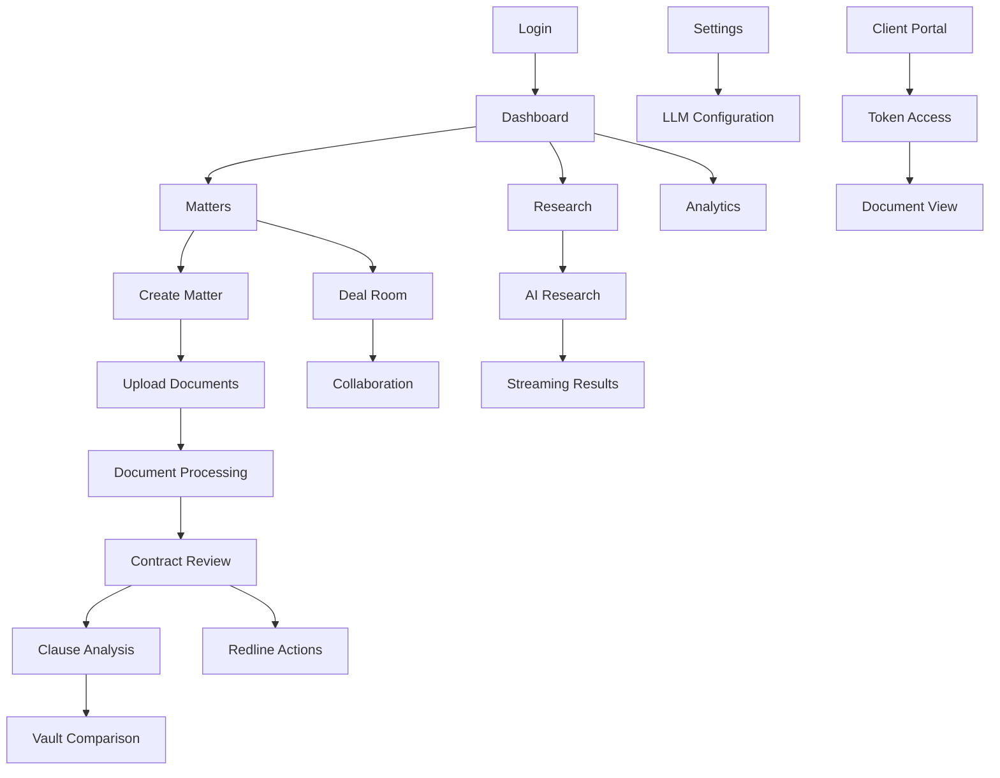

## 1. Product Overview

LexAI is a comprehensive legal intelligence SaaS platform that combines Harvey-style AI-powered legal research with Legora-style matter management. The platform enables legal teams to streamline contract review, clause extraction, risk assessment, and collaborative deal management in a unified workspace.

Legal professionals can upload documents, extract and analyze clauses with AI, conduct research with citation-grounded outputs, manage matters and tasks, collaborate in real-time, and share secure client portals - all while maintaining organization-level security and audit trails.

## 2. Core Features

### 2.1 User Roles

| Role | Registration Method | Core Permissions |
|------|---------------------|------------------|
| Admin | Email invitation or self-registration | Full organization management, user invites, LLM settings, audit logs |
| Lawyer | Email invitation | Matter creation, document upload, research, clause review, collaboration |
| Paralegal | Email invitation | Document processing, basic research, task management, limited editing |
| Client | Token-based portal access | Read-only access to specific matters/documents, acknowledgment/signing |

### 2.2 Feature Module

LexAI consists of the following main pages:

1. **Dashboard**: Overview of matters, tasks, recent documents, and key metrics
2. **Matters**: Matter list, creation, and detailed matter management with deal rooms
3. **Documents**: Document upload, parsing status, and document library
4. **Contract Review**: Three-panel contract viewer with clause highlights and analysis
5. **Research**: AI-powered legal research with streaming responses and citations
6. **Vault**: Clause library and playbook management
7. **Drafting**: Template-based document generation wizard
8. **Analytics**: Usage metrics, matter statistics, and audit logs
9. **Settings**: Organization and LLM provider configuration
10. **Client Portal**: Token-secured document access for external parties

### 2.3 Page Details

| Page Name | Module Name | Feature description |
|-----------|-------------|---------------------|
| Dashboard | Metrics overview | Display matter counts, task status, recent activity, and key performance indicators |
| Dashboard | Quick actions | Provide shortcuts to create matter, upload document, start research |
| Matters | Matter list | View, filter, and search all matters with status and party information |
| Matters | Matter creation | Create new matters with parties, status, and initial documentation |
| Matters | Deal room | Collaborative workspace with documents, tasks, timeline, and parties |
| Documents | Upload flow | Presigned upload to MinIO with drag-and-drop interface |
| Documents | Processing status | Track document parsing, chunking, and embedding progress |
| Documents | Document library | Browse and search uploaded documents with metadata |
| Contract Review | Clause navigator | Left panel showing extracted clauses grouped by risk level |
| Contract Review | PDF viewer | Center panel with react-pdf rendering and zoom controls |
| Contract Review | Clause analysis | Right panel with risk assessment, suggestions, and redline actions |
| Research | Query interface | Text input with matter and organization filters |
| Research | Streaming response | Real-time token streaming with citation cards |
| Research | History | Save and browse previous research queries and results |
| Vault | Clause library | Searchable repository of standard clauses and language |
| Vault | Playbooks | Organized clause collections with fallback logic |
| Drafting | Template selection | Choose from uploaded DOCX templates |
| Drafting | Variable input | Form-based completion of template placeholders |
| Drafting | AI generation | Generate editable first draft with configured LLM |
| Analytics | Usage metrics | Track research tokens, document processing, and user activity |
| Analytics | Matter statistics | Analyze matter lifecycle, close times, and risk distribution |
| Analytics | Audit logs | View and export security-relevant events |
| Settings | Organization config | Manage organization details and user invitations |
| Settings | LLM providers | Configure Ollama and OpenRouter settings per organization |
| Client Portal | Document viewer | Read-only access to specific documents with acknowledgment |
| Client Portal | Token authentication | Secure, time-limited access without user account |

## 3. Core Process

### Regular User Flow
Users begin by registering or accepting email invitations to join an organization. After authentication, they land on the dashboard showing their matters and tasks. They can create new matters, upload documents for AI processing, and collaborate with team members. Documents are automatically parsed and clauses are extracted with risk assessments. Users can conduct legal research with streaming AI responses and citations, compare clauses against organizational playbooks, and generate drafts from templates. Real-time collaboration enables commenting and presence indicators within matters.

### Client Portal Flow
External clients receive secure tokens via email granting time-limited access to specific matters or documents. They can view documents with clause highlights and risk indicators, add comments or acknowledgments, and complete required actions without requiring user accounts.

### Admin Flow
Administrators manage organization settings, configure LLM providers, invite users with appropriate roles, monitor usage analytics, and review audit logs for security compliance.

## 4. User Interface Design

### 4.1 Design Style
- **Primary Colors**: Neutral grays (#1f2937, #374151) with professional blue accent (#3b82f6)
- **Secondary Colors**: Semantic risk levels (green #10b981, amber #f59e0b, red #ef4444)
- **Button Style**: Rounded corners (4-6px radius), clear hover states, consistent sizing
- **Typography**: Inter font family, 14px base size, clear hierarchy with 1.25 ratio scaling
- **Layout**: Card-based components with subtle shadows, generous whitespace, clear section boundaries
- **Icons**: Minimalist line icons, consistent 20px base size, semantic color coding

### 4.2 Page Design Overview

| Page Name | Module Name | UI Elements |
|-------------|---------------|---------------|
| Dashboard | Metrics cards | Clean stat cards with subtle gradients, sparkline charts for trends, quick action buttons with icons |
| Matters | Data table | Sortable columns, status badges with colors, row hover effects, action dropdown menus |
| Contract Review | Three-panel layout | Resizable panels with drag handles, synchronized scrolling, floating toolbar for PDF controls |
| Research | Query interface | Large text input with matter selector, prominent search button, streaming response with typing animation |
| Document Viewer | PDF canvas | Zoom controls in floating toolbar, page thumbnails sidebar, loading skeleton during parse |
| Vault | Search interface | Filter sidebar with category checkboxes, search bar with instant results, card-based clause display |

### 4.3 Responsiveness
Desktop-first design with responsive breakpoints at 1280px, 1024px, 768px, and 640px. Complex features like contract review maintain three-panel layout on tablets with collapsible sidebars. Mobile views focus on single-task flows with bottom navigation for core actions. Touch interactions optimized for tablet document review.

### 4.4 Accessibility
Full keyboard navigation support, proper ARIA labels, high contrast mode compatibility, screen reader optimization, and focus-visible indicators. Document viewer includes semantic landmarks and alternative text descriptions for visual elements.