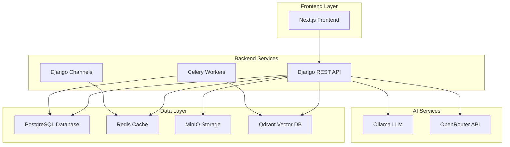
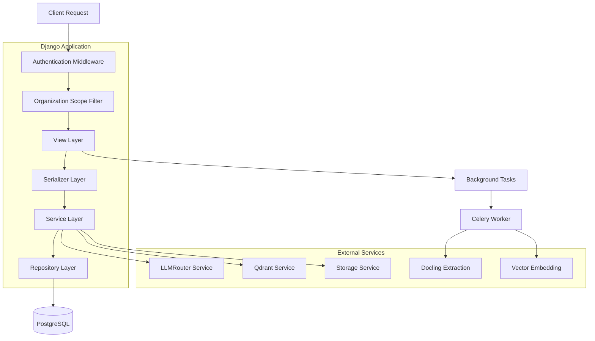
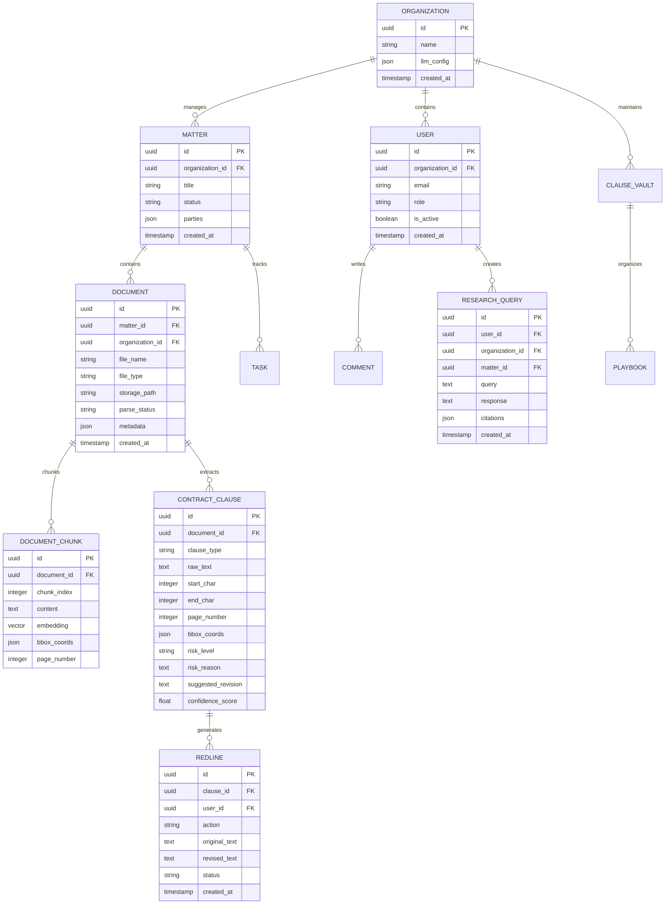

## 1. Architecture Design



## 2. Technology Description

- **Frontend**: Next.js 14 + TypeScript + Tailwind CSS
- **Backend**: Django 5 + Django REST Framework + SimpleJWT
- **Database**: PostgreSQL 16 with organization-scoped multi-tenancy
- **Cache**: Redis for sessions, real-time features, and task queuing
- **Object Storage**: MinIO for document storage with presigned URLs
- **Vector Search**: Qdrant for document chunks and clause embeddings
- **AI Models**: Ollama (local) + OpenRouter (cloud) via unified LLMRouter
- **Document Processing**: Docling for PDF/DOCX parsing and extraction
- **Task Queue**: Celery for background document processing
- **Real-time**: Django Channels with Redis channel layer
- **Testing**: pytest (backend) + Playwright (frontend E2E)
- **Container**: Docker Compose for local development

## 3. Route Definitions

| Route | Purpose |
|-------|---------|
| / | Marketing landing page |
| /auth/login | User authentication |
| /auth/register | User registration |
| /app/dashboard | Main dashboard with metrics |
| /app/matters | Matter list and management |
| /app/matters/[id] | Individual matter deal room |
| /app/research | AI legal research interface |
| /app/contracts/[id] | Contract review with three-panel viewer |
| /app/draft | Document drafting wizard |
| /app/vault | Clause library and playbooks |
| /app/analytics | Usage metrics and reports |
| /app/admin/audit | Security audit logs |
| /app/settings/llm | Organization LLM configuration |
| /client/[token] | External client portal access |

## 4. API Definitions

### 4.1 Authentication APIs

**Login**
```
POST /api/auth/login
```

Request:
| Param Name | Param Type | isRequired | Description |
|------------|-------------|-------------|-------------|
| email | string | true | User email address |
| password | string | true | User password |

Response:
```json
{
  "access": "eyJ0eXAiOiJKV1QiLCJhbGc...",
  "refresh": "eyJ0eXAiOiJKV1QiLCJhbGc...",
  "user": {
    "id": "uuid",
    "email": "user@example.com",
    "name": "John Doe",
    "role": "lawyer",
    "organization_id": "org-uuid"
  }
}
```

### 4.2 Matter APIs

**Create Matter**
```
POST /api/matters/
```

Request:
| Param Name | Param Type | isRequired | Description |
|------------|-------------|-------------|-------------|
| title | string | true | Matter title |
| description | string | false | Matter description |
| status | string | true | Matter status |
| parties | array | true | List of party objects |

**List Matters**
```
GET /api/matters/?status=active&page=1&limit=20
```

### 4.3 Document APIs

**Upload Document**
```
POST /api/documents/upload/
```

Request:
| Param Name | Param Type | isRequired | Description |
|------------|-------------|-------------|-------------|
| matter_id | uuid | true | Associated matter ID |
| file_name | string | true | Original file name |
| file_type | string | true | MIME type |
| file_size | integer | true | File size in bytes |

Response:
```json
{
  "presigned_url": "https://minio.example.com/upload/...",
  "document_id": "doc-uuid",
  "upload_fields": {
    "key": "documents/org-uuid/doc-uuid.pdf",
    "bucket": "lexai-documents"
  }
}
```

### 4.4 Research APIs

**Stream Research Query**
```
POST /api/research/stream/
```

Request:
| Param Name | Param Type | isRequired | Description |
|------------|-------------|-------------|-------------|
| query | string | true | Research question |
| matter_id | uuid | false | Filter by matter |
| context | string | false | Additional context |

Response: Server-Sent Events stream with JSON chunks

## 5. Server Architecture Diagram



## 6. Data Model

### 6.1 Entity Relationship Diagram



### 6.2 Data Definition Language

**Organizations Table**
```sql
CREATE TABLE organizations (
    id UUID PRIMARY KEY DEFAULT gen_random_uuid(),
    name VARCHAR(255) NOT NULL,
    llm_config JSONB DEFAULT '{"provider": "ollama", "models": {}}',
    created_at TIMESTAMP WITH TIME ZONE DEFAULT NOW(),
    updated_at TIMESTAMP WITH TIME ZONE DEFAULT NOW()
);

CREATE INDEX idx_organizations_created_at ON organizations(created_at);
```

**Users Table**
```sql
CREATE TABLE users (
    id UUID PRIMARY KEY DEFAULT gen_random_uuid(),
    organization_id UUID NOT NULL REFERENCES organizations(id) ON DELETE CASCADE,
    email VARCHAR(255) UNIQUE NOT NULL,
    password_hash VARCHAR(255) NOT NULL,
    name VARCHAR(255) NOT NULL,
    role VARCHAR(50) NOT NULL CHECK (role IN ('admin', 'lawyer', 'paralegal', 'client')),
    is_active BOOLEAN DEFAULT true,
    created_at TIMESTAMP WITH TIME ZONE DEFAULT NOW(),
    updated_at TIMESTAMP WITH TIME ZONE DEFAULT NOW()
);

CREATE INDEX idx_users_organization_id ON users(organization_id);
CREATE INDEX idx_users_email ON users(email);
```

**Matters Table**
```sql
CREATE TABLE matters (
    id UUID PRIMARY KEY DEFAULT gen_random_uuid(),
    organization_id UUID NOT NULL REFERENCES organizations(id) ON DELETE CASCADE,
    title VARCHAR(255) NOT NULL,
    description TEXT,
    status VARCHAR(50) NOT NULL DEFAULT 'active',
    parties JSONB DEFAULT '[]',
    created_by UUID REFERENCES users(id),
    created_at TIMESTAMP WITH TIME ZONE DEFAULT NOW(),
    updated_at TIMESTAMP WITH TIME ZONE DEFAULT NOW()
);

CREATE INDEX idx_matters_organization_id ON matters(organization_id);
CREATE INDEX idx_matters_status ON matters(status);
CREATE INDEX idx_matters_created_at ON matters(created_at DESC);
```

**Documents Table**
```sql
CREATE TABLE documents (
    id UUID PRIMARY KEY DEFAULT gen_random_uuid(),
    organization_id UUID NOT NULL REFERENCES organizations(id) ON DELETE CASCADE,
    matter_id UUID REFERENCES matters(id) ON DELETE CASCADE,
    file_name VARCHAR(255) NOT NULL,
    file_type VARCHAR(100) NOT NULL,
    file_size BIGINT NOT NULL,
    storage_path VARCHAR(500) NOT NULL,
    parse_status VARCHAR(50) DEFAULT 'pending',
    metadata JSONB DEFAULT '{}',
    uploaded_by UUID REFERENCES users(id),
    created_at TIMESTAMP WITH TIME ZONE DEFAULT NOW(),
    updated_at TIMESTAMP WITH TIME ZONE DEFAULT NOW()
);

CREATE INDEX idx_documents_organization_id ON documents(organization_id);
CREATE INDEX idx_documents_matter_id ON documents(matter_id);
CREATE INDEX idx_documents_parse_status ON documents(parse_status);
```

**Contract Clauses Table**
```sql
CREATE TABLE contract_clauses (
    id UUID PRIMARY KEY DEFAULT gen_random_uuid(),
    document_id UUID NOT NULL REFERENCES documents(id) ON DELETE CASCADE,
    clause_type VARCHAR(100) NOT NULL,
    raw_text TEXT NOT NULL,
    start_char INTEGER NOT NULL,
    end_char INTEGER NOT NULL,
    page_number INTEGER NOT NULL,
    bbox_coords JSONB NOT NULL,
    risk_level VARCHAR(20) CHECK (risk_level IN ('low', 'medium', 'high', 'critical')),
    risk_reason TEXT,
    suggested_revision TEXT,
    confidence_score FLOAT,
    extracted_by VARCHAR(50) DEFAULT 'ai',
    created_at TIMESTAMP WITH TIME ZONE DEFAULT NOW()
);

CREATE INDEX idx_clauses_document_id ON contract_clauses(document_id);
CREATE INDEX idx_clauses_risk_level ON contract_clauses(risk_level);
CREATE INDEX idx_clauses_clause_type ON contract_clauses(clause_type);
```

**Research Queries Table**
```sql
CREATE TABLE research_queries (
    id UUID PRIMARY KEY DEFAULT gen_random_uuid(),
    organization_id UUID NOT NULL REFERENCES organizations(id) ON DELETE CASCADE,
    user_id UUID NOT NULL REFERENCES users(id),
    matter_id UUID REFERENCES matters(id) ON DELETE CASCADE,
    query TEXT NOT NULL,
    response TEXT,
    citations JSONB DEFAULT '[]',
    model_used VARCHAR(100),
    tokens_used INTEGER,
    created_at TIMESTAMP WITH TIME ZONE DEFAULT NOW()
);

CREATE INDEX idx_research_org_id ON research_queries(organization_id);
CREATE INDEX idx_research_user_id ON research_queries(user_id);
CREATE INDEX idx_research_created_at ON research_queries(created_at DESC);
```

## 7. Vector Search Configuration

**Qdrant Collections**
```python
# Document chunks collection
{
    "name": "document_chunks",
    "vectors": {
        "size": 768,  # nomic-embed-text dimension
        "distance": "Cosine"
    },
    "payload_schema": {
        "organization_id": "keyword",
        "document_id": "keyword",
        "matter_id": "keyword",
        "page_number": "integer"
    }
}

# Clause library collection
{
    "name": "clause_library",
    "vectors": {
        "size": 768,
        "distance": "Cosine"
    },
    "payload_schema": {
        "organization_id": "keyword",
        "clause_type": "keyword",
        "risk_level": "keyword"
    }
}
```

## 8. Security Considerations

- **JWT Authentication**: Access tokens (15min) + refresh tokens (7 days)
- **Organization Scoping**: All database queries filtered by organization_id
- **File Upload Security**: MIME type validation, size limits, virus scanning hooks
- **Rate Limiting**: AI endpoints limited per organization and user
- **CORS**: Strict origin whitelist, credentials-only for authenticated routes
- **Audit Logging**: All data modifications logged with user context
- **Client Tokens**: Short-lived (24h), single-use, scoped to specific resources
- **MinIO Security**: Presigned URLs with expiration, bucket policies per organization

## 9. Background Job Processing

**Celery Task Types:**
- `process_document_upload`: Parse PDF/DOCX with Docling, extract text and metadata
- `generate_document_embeddings`: Create vector embeddings for document chunks
- `extract_contract_clauses`: AI-powered clause extraction and risk assessment
- `send_notification_emails`: Handle comment notifications and task assignments
- `cleanup_expired_tokens`: Remove expired client portal tokens
- `generate_usage_analytics`: Calculate organization usage metrics

## 10. Real-time Features

**WebSocket Events:**
- `matter.presence`: User join/leave in matter rooms
- `comment.created`: New comments on documents
- `comment.updated`: Comment edits and resolutions
- `task.assigned`: Task assignment notifications
- `document.processed`: Document parsing completion
- `clause.highlighted`: Clause selection synchronization

**Channel Authorization:**
- JWT token validation on connection
- Organization membership verification
- Matter access permission checks
- Read vs write role-based permissions